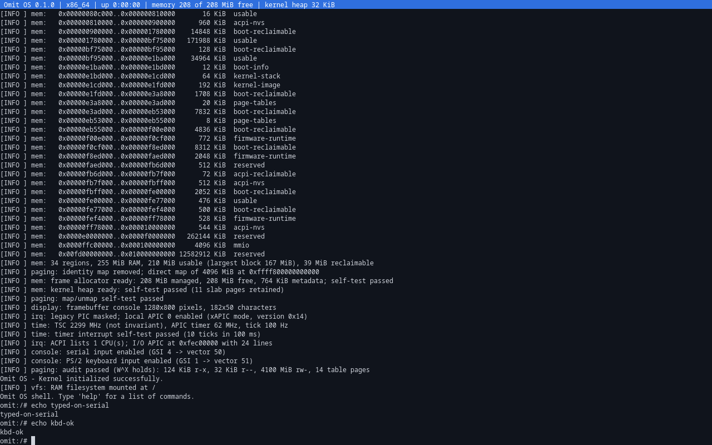
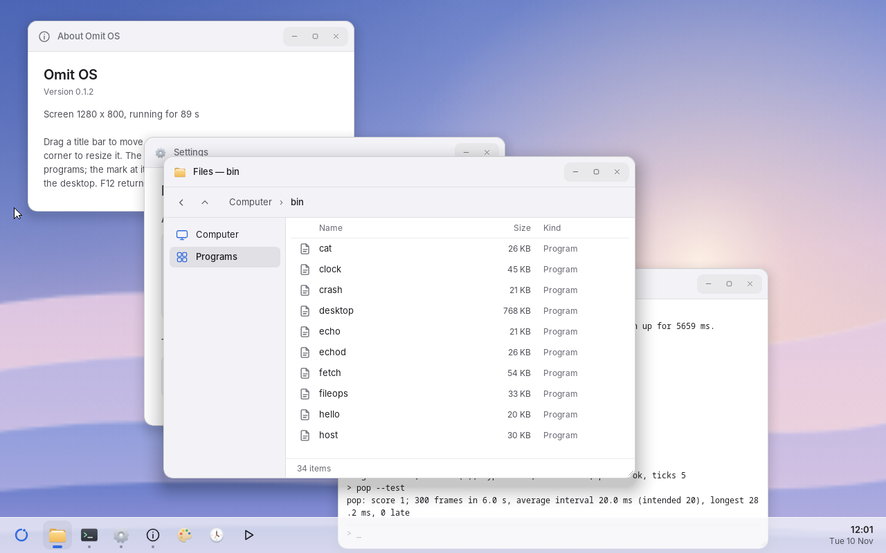
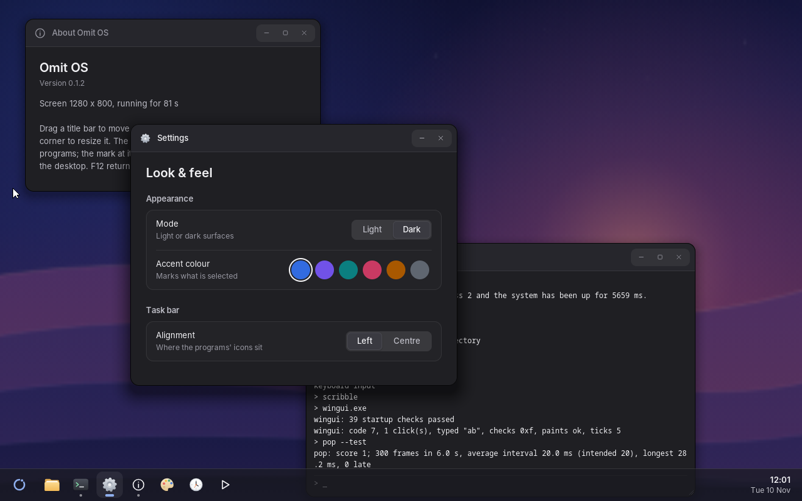
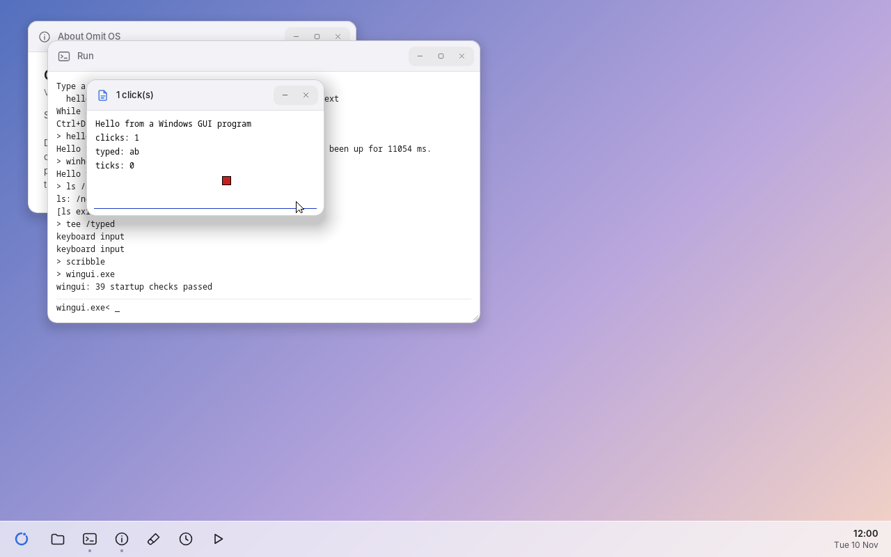

# Omit OS

> Everything you need. Nothing you don't.

## What it is, and what it is not

Omit OS aims to feel familiar to people coming from Windows — the same
kind of workflows, shortcuts, task bar and file management — and to run
Windows applications through its own compatibility layer. That layer is
at an early stage: today it runs small test programs written for it, not
existing applications (see [Status](#status)).

Omit OS is an independent, open-source project. It is not affiliated
with, sponsored by, or endorsed by Microsoft Corporation or Apple Inc.
Windows is a trademark of Microsoft Corporation; macOS is a trademark of
Apple Inc. These names are used only to describe compatibility.

All code and visual assets are original or used under open licences. No
proprietary code or assets from Microsoft or Apple are included. See
[IP_POLICY.md](IP_POLICY.md) and [ATTRIBUTION.md](ATTRIBUTION.md); the
project's own name is covered by [TRADEMARKS.md](TRADEMARKS.md).

## Overview

Omit OS is a from-scratch operating system for x86-64 with its own kernel,
written in Rust. It is not a Linux distribution: the kernel is independent,
and the only Linux code in the tree is individual device drivers reused
unmodified (currently two; see `drivers/linux/`). It contains no Windows code.

**This is an early-stage kernel.** Today it boots under UEFI, takes control of
the CPU and the address space, manages memory, handles timer and device
interrupts, schedules threads, and runs programs as isolated user-mode
processes. You get an interactive shell with a RAM filesystem, on screen
(with a PS/2 or USB keyboard) and on the serial console, and can format, mount and
use an ext2 filesystem on a VirtIO disk. Two unmodified Linux drivers run
on a compatibility layer, simple Windows console executables run natively
(no emulation, no Windows code), and there is a small graphical desktop.
It can install itself onto a SATA, NVMe or VirtIO disk — tested only in
virtual machines so far. With a VirtIO or Intel e1000 network card it gets an address by
DHCP, can `ping`, and programs can use UDP and TCP (there are a name
lookup tool and TFTP and HTTP download tools, the latter also over TLS — with unaudited cryptography, see ADR 0025). See [Status](#status) for exactly what exists, how
narrow each of those is, and what has been tested.



Typing `desktop` at the prompt starts a small graphical desktop, drawn to
the project's own design system (eight stages of it so far; see ADR 0023).
These screenshots are taken from QEMU by the automated test: the Files
window in front of others, and Settings just after "Dark" was chosen:





Programs can have windows of their own — including Windows programs.
Here `wingui.exe`, an ordinary PE executable using `USER32.dll` and
`GDI32.dll` functions, has been clicked once and typed into (the
screenshot is taken by the automated test):



The same session on the serial console:

```text
omit-boot: Omit OS boot loader 0.1.0 (protocol v1)
omit-boot: kernel image: 1649912 bytes
omit-boot: kernel loaded at phys 0x3e03000, entry 0xffffffff80008120; direct map 4 GiB (2 MiB pages)
omit-boot: exiting boot services

[INFO ] Omit OS kernel 0.1.0 (x86_64, release build)
[INFO ] serial: COM1 16550 UART ready (115200 8N1), loopback test passed
[INFO ] boot: protocol v1, command line ""
[INFO ] boot: kernel image 0xffffffff80000000..0xffffffff8002a000 at phys 0x3e03000 (168 KiB)
[INFO ] boot: ACPI RSDP at phys 0x577e014
[INFO ] cpu: AuthenticAMD | NX=on WP=on SMEP=unsupported SMAP=unsupported UMIP=unsupported 1GiB-pages=no
[INFO ] cpu: GDT and TSS loaded (double-fault stack on IST1)
[INFO ] cpu: IDT loaded, 256 vectors installed, #BP self-test passed
[INFO ] mem: 38 regions, 95 MiB RAM, 46 MiB usable (largest block 34 MiB), 43 MiB reclaimable
[INFO ] paging: identity map removed; direct map of 4096 MiB at 0xffff800000000000
[INFO ] mem: frame allocator ready: 45 MiB managed, 45 MiB free, 284 KiB metadata; self-test passed
[INFO ] mem: kernel heap ready: self-test passed (11 slab pages retained)
[INFO ] paging: map/unmap self-test passed
[INFO ] irq: legacy PIC masked; local APIC 0 enabled (xAPIC mode, version 0x14)
[INFO ] time: TSC 2099 MHz (not invariant), APIC timer 62 MHz, tick 100 Hz
[INFO ] time: timer interrupt self-test passed (10 ticks in 100 ms)
[INFO ] irq: ACPI lists 1 CPU(s); I/O APIC at 0xfec00000 with 24 lines
[INFO ] console: serial input enabled (GSI 4 -> vector 50)
[INFO ] paging: audit passed (W^X holds): 120 KiB r-x, 20 KiB r--, 4096 MiB rw-, 17 table pages
Omit OS — Kernel initialized successfully.
[INFO ] vfs: RAM filesystem mounted at /
Omit OS shell. Type 'help' for a list of commands.
omit:/# mkdir -p /home/user/docs
omit:/# cd /home/user
omit:/home/user# pwd
/home/user
omit:/home/user# echo hello from omit > greeting.txt
omit:/home/user# cat greeting.txt
hello from omit
```

## Quick start

### Prerequisites

| Tool | Purpose | Debian/Ubuntu |
| --- | --- | --- |
| [rustup](https://rustup.rs) | Rust toolchain (version, components and targets are pinned in `rust-toolchain.toml` and installed automatically) | — |
| clang or gcc | compiling the reused Linux drivers into the kernel | `apt install clang` |
| QEMU (x86-64 system emulator) | running and testing | `apt install qemu-system-x86` |
| e2fsprogs (optional) | independent check of the ext2 driver in the tests | `apt install e2fsprogs` |
| OVMF | UEFI firmware for QEMU | `apt install ovmf` |
| GDB (optional) | kernel debugging | `apt install gdb` |

No other host tools are needed; the disk image is produced by the build driver
itself. Set `OMIT_CC` to choose the C compiler.

### Build, run, test

```bash
cargo xtask run
```

Builds the loader and kernel, assembles a bootable disk image and boots it in
QEMU with the serial console on your terminal. You land in the Omit OS shell;
type `help` for the commands. Press `Ctrl-C` to stop QEMU. (`xtask` runs QEMU
without a window; to see the screen, boot the image yourself as shown under
[Releases](#releases).)

```bash
cargo xtask test
```

Runs the QEMU integration tests (see [Testing](#testing)).

```bash
cargo test
```

Runs the host-side unit tests.

All `xtask` commands:

| Command | Effect |
| --- | --- |
| `cargo xtask build` | Build `omit-boot.efi` and the `omit-kernel` ELF |
| `cargo xtask image` | Also write `target/omit/<profile>/omit-os.img` (GPT + FAT32 ESP) |
| `cargo xtask dist` | Build the release artifacts: versioned disk image and ISO in `target/omit/dist/` |
| `cargo xtask run` | Also boot the image in QEMU |
| `cargo xtask test` | Build and run the QEMU integration tests (TAP output) |

Options: `--release`, `--cmdline "<text>"` (image/run), `--cpu <model>`,
`--memory <size>`, `--accel <name>` (e.g. `kvm`), `--only <test>` (run a
single boot test), `--iso` (use an ISO instead of
a disk image), `--gdb` (run). `xtask run` also attaches a 32 MiB VirtIO data
disk (`target/omit/<profile>/omit-data.img`) that persists between runs; try
`mkfs vda`, `mkdir /mnt`, `mount vda /mnt`. Environment: `QEMU`, `OVMF_CODE` +
`OVMF_VARS` (if the firmware is not in a standard location),
`OMIT_TEST_TIMEOUT`.

### Kernel command line

Stored in `\EFI\OMIT\CMDLINE` on the boot volume; set it with `--cmdline`.

| Token | Effect |
| --- | --- |
| `noshell` | Do not start the interactive shell after initialisation. |
| `nops2` | Do not use the PS/2 keyboard and mouse. For tests of USB input. |
| `calibrate=pmtimer` | Measure the clocks against the ACPI power-management timer even if the PIT works. For tests. |
| `qemu-exit` | Report final status through QEMU's `isa-debug-exit` device and terminate the VM. Only for use under QEMU. |
| `fault=panic` \| `pagefault` \| `stackoverflow` | Deliberately crash after initialisation, to exercise the diagnostics. Test use only. |

### Debugging with GDB

```bash
cargo xtask run --gdb
```

QEMU starts paused with a GDB server on `localhost:1234`. In another terminal:

```bash
gdb target/x86_64-unknown-none/debug/omit-kernel -ex 'target remote :1234' -ex 'hbreak _start' -ex 'continue'
```

Use hardware breakpoints (`hbreak`) for anything set before the kernel is
running: its addresses are not mapped while the firmware is still in charge.

Panic and exception reports include a backtrace of raw return addresses.
Resolve them with:

```bash
addr2line -f -C -e target/x86_64-unknown-none/debug/omit-kernel 0xffffffff80000fef
```

## Releases

Tagged versions are published on the repository's Releases page with two
images and their checksums:

| File | Use |
| --- | --- |
| `omit-os-<version>-x86_64.iso` | virtual machines (attach as optical drive, enable EFI), optical media |
| `omit-os-<version>-x86_64.img` | USB sticks (`dd`), virtual hard disks |

Both are live systems: they run from memory and leave the machine's disks
alone. `install DEVICE --erase` installs the system onto a SATA, NVMe or VirtIO
disk (see [`docs/RELEASE_NOTES.md`](docs/RELEASE_NOTES.md)). That has
been tested in virtual machines only; installing on a real computer has
never been tried.

```bash
qemu-system-x86_64 -machine q35 -m 256M -bios /usr/share/ovmf/OVMF.fd -cdrom omit-os-0.2.0-x86_64.iso -serial stdio
```

To cut a release, set the version in `Cargo.toml`, merge, then push a
matching tag:

```bash
git tag v0.2.0 && git push origin v0.2.0
```

The release workflow tests the exact binaries from both media before
publishing. See [`docs/RELEASE_NOTES.md`](docs/RELEASE_NOTES.md).

### Real hardware

**Not tested on real hardware.** Requirements: x86-64, UEFI, Secure Boot off.
The screen should work wherever the firmware provides a 32-bit framebuffer.
Keyboard input needs a PS/2 keyboard, or a USB keyboard on an xHCI
controller (directly or through hubs; the USB driver has only been
tested in QEMU); otherwise the only way to type is a serial port
(COM1, 115200 8N1). A serial port is not needed: without one the system
uses the screen and keyboard alone.

## Status

Milestones 0 (development environment), 1 (bootable kernel), 2 (memory and
interrupts), 3 (terminal and filesystem), 4 (processes and userspace),
5 (storage; coreutils only in part), 6 (driver compatibility, first
instance), 7 (Windows executables, first instance) and 8 (graphics and a
desktop, first instance) are implemented. Of Milestone 9 (advanced
compatibility), the parts that could be built and tested were: DLL
support, a first slice of the Windows GUI, a second Linux driver family,
and measurements of input latency and frame pacing; Direct3D, Vulkan, GPU
acceleration and existing games were investigated only (ADR 0013).

"First instance" means what it says: two small Linux drivers; Windows
programs written for the purpose, using about 125 functions of three
system libraries — no existing Windows application runs; a desktop with a
handful of built-in windows and a minimal protocol for other programs'
windows. Milestones 6 to 9 are open-ended by nature, and nothing here
should be read as those goals being reached.

Storage (VirtIO, NVMe, SATA), USB input, the clock and the installer have
native drivers that are **tested in QEMU only**. Outside QEMU, the
release ISO has been booted to the shell in VirtualBox 7 (with EFI
enabled) by the project's owner; nothing beyond that boot has been
checked there, and the first attempt found a loader bug that QEMU's
firmware had tolerated. The system has never been run on a physical
machine.

| Component | State |
| --- | --- |
| UEFI loader: file loading, ELF validation, page tables, memory map conversion, hand-off | Working, tested in QEMU |
| Kernel entry, boot-information validation, command line | Working, tested |
| Serial console (16550, polled) and levelled logging | Working, tested |
| CPU setup: NX, write-protect, SMEP/SMAP/UMIP when available | Working, tested |
| GDT, TSS, IDT for all 256 vectors, exception handlers, double-fault stack | Working, tested (breakpoint round-trip, page fault, stack overflow) |
| Physical memory map: validation and reporting | Working, tested |
| Address space: identity map removal, live page-table W^X audit | Working, tested |
| Panic handler with location and backtrace | Working, tested |
| Physical frame allocator (buddy, orders 0-10) | Working; algorithm host-tested, kernel integration self-tested at every boot |
| Kernel heap (size classes 16 B-2 KiB, larger requests from the frame allocator); `alloc` crate available in the kernel | Working; algorithm host-tested, kernel integration self-tested at every boot |
| Page mapping: device memory (`map_mmio`), kernel pages (map, unmap with TLB flush, translate) | Working; self-tested at every boot, plus a use-after-unmap fault test |
| Interrupt-safe spinlock, interrupt handler registration and dispatch | Working, tested |
| Legacy PIC masking, local APIC (xAPIC mode) | Working, tested |
| Local APIC in x2APIC mode | Working; tested in CI under KVM (QEMU's software emulation does not offer x2APIC, so it cannot be tested without KVM) |
| Clocks: TSC monotonic clock and 100 Hz APIC timer tick, calibrated against the PIT | Working; tick rate verified against the TSC at every boot |
| ACPI static tables (RSDP, RSDT/XSDT, MADT), I/O APIC | Working; parser host-tested, used at every boot |
| Interrupt-driven serial input, line editing | Working, tested end to end |
| Virtual filesystem layer and RAM filesystem | Working; host-tested, exercised end to end through the shell |
| Shell with built-in `help echo pwd cd ls cat mkdir touch cp mv rm uname clear exit`, quoting and `>`/`>>` | Working; host-tested and driven over the serial port in the QEMU tests |
| Kernel threads, preemptive round-robin scheduler, sleep, wait queues | Working; self-tested at every boot (including preemption of a thread that never yields) |
| User mode: per-process address spaces, ELF loader, `syscall`/`sysret` entry | Working; tested end to end in QEMU |
| System calls: `exit`, `write`, `read`, `open`, `close`, `map`, `unmap`, `protect`, `stat`, `readdir`, `mkdir`, `remove`, `rename`, `spawn`, `wait`, `kill`, `getpid`, `yield`, `sleep`, `uptime`, `set_thread_pointer`, `display_info`, `display_acquire`, `display_release`, `display_blit`, `input_read`, `clock`, `pipe`, `thread_create`, `thread_exit`, `futex_wait`, `futex_wake`, `shared_create`, `shared_map`, `channel_listen`, `channel_accept`, `channel_connect`, `poll`, `realtime`, `seek`, `system_info`, `task_list`, `random` | Working, tested |
| Date and time: read from the PC real-time clock at start-up (taken as UTC), `date` command, Windows time functions | Working, tested in QEMU with a fixed emulated clock; no time zones, no way to set the clock. See ADR 0021 |
| Heap for programs: the Rust `alloc` crate works in user space | Working, tested (1 M-element vector, 5000-node map, repeated 8 MiB blocks) |
| Output redirection (`>`, `>>`) for programs | Working, tested |
| Program arguments, standard input (line-edited, Ctrl-D ends input), per-process working directory and open files | Working, tested |
| Kernel-wide root filesystem behind a sleeping mutex, shared by the shell and by programs | Working, tested |
| Fault containment: a crashing program is terminated, the system continues | Working, tested (bad pointers to the kernel, direct kernel memory access) |
| Shell: run programs from `/bin` or by path, `&` for background, `ps`, `kill`, `free` | Working, tested |
| Userspace runtime (`omit-rt`) and programs `cat`, `echo`, `tee`, `ls`, `run`, `hello`, `sleeper`, `spin`, `crash`, `memtest`, `fileops`, `syscheck`, `pipetest`, `threadtest`, `random` | Working; shipped in the initial ramdisk |
| Framebuffer console with status bar (text only) | Working; verified by screenshot in the QEMU tests |
| PS/2 keyboard (US layout) | Working; verified by injected key presses in the QEMU tests |
| USB keyboards and mice on xHCI controllers (boot protocol, polled; hot-plug), directly or through hubs | Working in QEMU: tests type on a USB keyboard — plugged in directly, and behind a hub with the mouse behind a second hub — and one runs the whole desktop scenario with USB keyboard and mouse, PS/2 switched off. **Never run on real hardware.** See ADR 0019 |
| Other USB devices (storage, anything else) | Not started |
| Bootable ISO, release workflow | ISO boot tested in QEMU; the release workflow itself has not run yet (it needs a tag) |
| PCI device discovery (`lspci`) | Working, tested in QEMU |
| VirtIO block driver (polling, one request at a time) | Working, tested in QEMU |
| AHCI driver for SATA disks (first controller, ATA disks with 48-bit addressing and 512-byte sectors, polling, one 4 KiB command at a time; disks named by port: `sda` is port 0) | Working against QEMU's emulated controller; **never run on real hardware**. No CD/DVD drives. See ADR 0020 |
| NVMe driver (first controller, namespace 1, 512-byte sectors, polling, one 4 KiB command at a time) | Working against QEMU's emulated controller; **never run on a real NVMe disk**. See ADR 0017 |
| Networking, first steps: drivers for the VirtIO network card and for Intel's 82540EM/82545EM ("e1000", written from Intel's manual), both polling; ARP, IPv4, an address by DHCP, answering and sending echo requests (`ifconfig`, `ping`) | Working in QEMU: the test gets an address from QEMU's DHCP server and pings the gateway; protocol logic host-tested. No driver for a real network card. See ADR 0022 |
| TCP for programs (`tcp_connect`, `tcp_listen`, `tcp_accept`; connections are read, written and polled like files); `fetch` downloads over HTTP, `echod` is an echo server | Working in QEMU: downloads from a web server run by the test are compared byte for byte, and the host exchanges 20 000 bytes with a server in the guest. The protocol is host-tested against a simulated network that loses, duplicates and reorders. **A small, slow TCP: no congestion control, no window scaling** |
| TLS 1.3 for programs (`omit-tls`: rustls with the pure-Rust RustCrypto provider; Mozilla's list of authorities, or one's own with `fetch --trust FILE`); `fetch` takes `https://` addresses; kernel random numbers (`random`) | Working in QEMU against a TLS server run by the test: downloads compared byte for byte, and refusals of an unknown authority, a cut connection and a server without TLS; the client is host-tested against a real TLS server (wrong name, expired, not yet valid). **The cryptography provider is an early, unaudited release; no revocation checks; no TLS 1.2; never tried against a server on the Internet.** See ADR 0024 and ADR 0025 |
| UDP sockets for programs (`udp_bind`, `udp_send`, `udp_receive`, `net_info`; usable with `poll`); `tftp` fetches files, `host` looks names up | Working in QEMU: files fetched from QEMU's TFTP server and compared, names asked of a name server run by the test, and `/bin/nettest` checks the system calls and their refusals. IPv4 only; name lookup is a separate program, so other commands take addresses only |
| ext2 filesystem: read/write, `mkfs`, mount/unmount at any directory | Working. Host tests verify images with `e2fsck` and exchange files with `debugfs`/`mke2fs`; the QEMU test formats and fills a disk, reboots, reads it back and runs `e2fsck` on the result |
| Hardware database: device names and support status in `lspci` | Working, host-tested |
| Driver registry (`lsdrv`), unbinding of Linux drivers (`unbind`) | Working, tested |
| LinuxKPI: unmodified Linux driver for the Intel 6300ESB watchdog (Linux v6.12) | Working **in QEMU only**: probe, start/stop, keep-alives prevent the reset, expiry resets the machine, unbind. Not a general Linux driver layer; see ADR 0010 |
| LinuxKPI: unmodified Linux `pvpanic` driver (a second subsystem: notifier chains, lists, spinlocks, device attributes) | Working **in QEMU only**: probe, attributes via `devattr`, unbind, kernel panic reported to the hypervisor |
| PCI: assignment of memory BARs that firmware left unassigned | Working for the one case that needs it (QEMU pvpanic under OVMF); a simple placement rule, bus 0 only |
| Loadable drivers, driver packages, automatic driver installation | Not started |
| Pipes between processes; standard input, output and error connectable to pipes or files at `spawn`; non-waiting reads | Working; self-tested at every boot and by `/bin/pipetest` (300 KB through a filter) |
| Shell pipelines (`a \| b \| c`) and input redirection (`< file`) | Working; host-tested and run in QEMU, including Windows programs in pipelines |
| Shared memory segments, named channels between unrelated programs, `poll` over descriptors and input | Working; `/bin/ipctest` checks sharing across processes, segment lifetime, connect/accept, wake-ups and timeouts. No permissions: see ADR 0018 |
| Threads within a process (shared address space, `thread_create`, process-wide exit), futex, user-space mutex and join | Working on one CPU; `/bin/threadtest` checks contention, the shared heap, futex semantics and process exit with threads still running |
| Environment variables, signals, shared memory, more than one CPU | Not started |
| GUID partition tables: partitions of the VirtIO disk as block devices (`vda1`, ...) | Working; library host-tested including damaged and hostile tables |
| Installer (`install DEVICE --erase`): GPT, FAT16 system partition, ext2 data partition mounted at `/data` on the installed system | Working **on SATA, NVMe and VirtIO disks under QEMU**: the tests install, restarts from the disk alone, and verifies the disk on the host with independent tools. See ADR 0016 |
| USB storage, root filesystem on disk, updates in place | Not started |
| SMP | Not started |
| SSE/x87 state saved per process; `protect` and `set_thread_pointer` system calls | Working, tested (the SSE test was confirmed to fail without the save/restore) |
| PE32+ parser (`compat/windows/pe`): headers, sections, imports, relocations | Working; host-tested including truncation and 200 000 random corruptions |
| Windows program loader `winrun`: mapping, relocation, import binding, W^X section rights, stack, TEB/PEB | Working, tested in QEMU |
| Windows API: 82 functions of `KERNEL32.dll` (console, files with positioning, directories and listings, heap, virtual memory, time and date, starting and waiting for other programs, process and module information, threads and synchronisation) | Working, tested by a Windows program that checks 94 results. **Only programs importing nothing else from Windows (but see the next row) can run**; see ADR 0011 |
| Windows GUI, first slice: 28 functions of `USER32.dll` and 14 of `GDI32.dll` — window classes, one fixed-size top-level window per `CreateWindowExA`, the message loop, painting with text, rectangles, lines and pixels, keyboard and mouse messages, timers, `MessageBoxA` | Working; `wingui.exe` is operated by the QEMU test with mouse and keyboard and checked on screenshots. No controls, menus, dialogs, bitmaps or `...W` functions: enough for a hand-written demonstration program, not for existing applications |
| Windows libraries (DLL files): export tables, loading with dependencies, initialisation order, `LoadLibraryA`, `GetProcAddress` | Working, tested with two DLLs built in this repository (33 checks). No Windows system DLL exists here |
| Windows programs started by name from the shell or by `spawn`; missing functions reported before start | Working, tested |
| PS/2 mouse | Working; decoder host-tested, driven by injected movement and clicks in the QEMU tests |
| Display for programs: exclusive ownership, pixel blits, keyboard and mouse events; console restored when the owner exits or the kernel panics | Working, tested in QEMU |
| Graphics library (`libs/gfx`): clipped drawing, text, window manager with incremental repainting | Working; host-tested, including equivalence of incremental and full repaints |
| Desktop (`/bin/desktop`), drawn to the project's design system: rounded windows with shadows that can be moved, resized by a corner, minimised and maximised; a task bar with the Start mark, program icons and a clock; a Start panel with search; a file manager (browse, new folder, rename, delete), a text editor (Notes), program runner, calculator, System Monitor (processes with their processor share, one of which can be ended; a minute of processor and memory use) and Settings (light or dark, six accent colours, task bar alignment — remembered); windows dragged to a screen edge take that half or the whole screen; Alt+Tab switches between windows and Alt+F4 closes one; the mouse wheel scrolls lists and text; the design's wallpapers, icons and typeface | Working; the QEMU test opens windows from the task bar, types commands, runs a native and a Windows program, drags a window, maximises, minimises and restores it, switches to dark mode and back in Settings, opens a folder in Files and makes one there, arranges a window by dragging it to an edge, calculates, finds itself in the System Monitor's list, switches windows with Alt+Tab, writes and saves a note, finds the chosen accent in the settings file, and ends the desktop from the Start panel, checking screenshots. Resizing by the corner is tested on the host only. **Eight stages of the design: many of its screens do not exist yet.** See ADR 0023 |
| Windows for other programs: protocol (`libs/window`), client library, `/bin/scribble` (drawing) and `/bin/clock` | Working; the QEMU test draws in a client window with the mouse, sends keys, checks the title the program sets and that the window goes when the program ends. Fixed-size windows, whole-window repaints, no permissions (ADR 0018) |
| Input latency: events are timestamped, delivered by wake-up rather than polling, and the desktop reports input-to-screen times | Working; measured under emulation (an average of about 8 ms in a release build with the current drawing code; see ADRs 0013 and 0023). No frame pacing: the display has no vertical-blank signal |
| A terminal emulator, resizable windows for other programs, minimising, graphics modes | Not started |
| A small game (`/bin/pop`: click the shrinking discs) redrawing 50 times a second, with frame pacing against the clock | Working; the QEMU test plays one move and the game reports its frame intervals (average 20.0 ms at the intended 20 ms, longest 25–30 ms under emulation; ADR 0013). Not synchronised to the display, and only multiples of the 10 ms timer tick can be paced |
| GPU drivers and acceleration, Vulkan, Direct3D, existing games | Not started; requirements and a proposed order of work are in ADR 0013 |
| Windows threads: `CreateThread`, exit codes, `WaitForSingleObject`, events, mutexes, semaphores, `WaitForMultipleObjects`, critical sections, `Tls*` storage, per-thread TEB | Working, tested by a multi-threaded Windows program (44 checks) |
| Windows: C runtime, exceptions, static TLS, graphics, registry, networking, 32-bit programs | Not started |

### What has been verified, and how

On QEMU 8.2.2 with OVMF, Rust 1.97.0 — locally with software emulation
(TCG), and in CI additionally under KVM on the runner's host CPU:

- 128 host unit tests (`cargo test`): boot protocol validation, memory map
  validation/merging, command line parsing, ELF parsing including malformed
  input, the buddy allocator and the heap (each including a randomised test
  against an independent model), ACPI table parsing, the VFS and RAM
  filesystem, the shell's parser, line editor and every command, the terminal
  emulator and keyboard decoder, the ext2 driver (checked against
  e2fsprogs), the hardware database, GPT and ISO writers.
- 10 QEMU integration tests (`cargo xtask test`), in debug and release builds,
  with `-cpu max` and with `-cpu qemu64` (no 1 GiB pages, SMEP, SMAP or UMIP),
  with 96 MiB to 6 GiB of guest RAM, and booted from both the disk image and
  the ISO.
- At every boot the kernel itself checks: a breakpoint exception round-trip;
  frame allocation, alignment, memory read-back and rejection of invalid
  frees; heap use through `Box`, `Vec` and `String` with nothing leaked;
  mapping, aliasing and unmapping of a page; thread scheduling including
  preemption; that ten timer interrupts arrive and take 100 ms ± a factor of two
  by the TSC; and that no mapping is writable and executable.
- `cargo fmt --check` and `cargo clippy -D warnings` for host crates, kernel
  and loader.
- GDB attach and breakpoint at `_start`; `addr2line` on a panic backtrace
  (verified for the first milestone; not re-run since).
- Release disk images are byte-identical across clean rebuilds.

### Known limitations and untested behaviour

- **Never run on real hardware** or with firmware other than OVMF. KVM has
  only been exercised in CI.
- Without a COM1 serial port the kernel uses the screen and keyboard
  alone (tested in QEMU). A machine with neither a serial port nor a
  firmware framebuffer shows nothing.
- Graphics are limited to the firmware's framebuffer at its boot
  resolution. Other programs can open windows, but only fixed-size
  ones, one per connection, without resizing, menus or a clipboard; the
  Run window is a line-mode terminal without escape sequences (see ADRs
  0012, 0014 and 0018). Debug builds draw noticeably slowly
  under emulation.
- Keyboards (US layout) and mice: PS/2, or USB on an xHCI controller;
  USB is untested outside QEMU.
- Networking works on a VirtIO network card and on two Intel cards
  (82540EM, 82545EM) — and both drivers have met only QEMU's emulation
  of those cards, never a real one, nor VirtualBox's or VMware's
  versions of them. Programs have UDP and a small TCP (no
  congestion control, so unsuited to anything but a local network),
  and TLS 1.3 for `https://` addresses in `fetch`, on a cryptography
  library that has **not been audited**, compiled without vector
  instructions, with no knowledge of revoked certificates, and never
  yet tried against a server on the Internet (see ADR 0025). It should
  not carry anything whose secrecy matters.
- Installation works onto SATA, NVMe and VirtIO disks and has only been
  tested with QEMU's emulated ones; there is no USB storage driver. An installed system still runs from memory; only `/data`
  persists.
- A file in the RAM filesystem (everything outside a mounted disk) can be
  as large as memory allows, up to 1 GiB, and so can a program's file
  (the loader reads it part by part).
- The disk filesystem has no journal and no cache: it is slow, and a crash
  mid-operation can leave it needing `e2fsck`.
- Clock calibration needs the legacy PIT or, where that does not count,
  the ACPI power-management timer (when both work, each checks the
  other). A machine with neither reports a calibration timeout and
  stops; CPUID- or HPET-based calibration is future work. The TSC is
  used as the clock even when the CPU does not
  advertise it as invariant (a warning-worthy condition on real hardware,
  normal under emulation).
- The tick is periodic at 100 Hz even when idle; tickless idle is future
  work.
- The frame allocator manages usable RAM above 1 MiB only. Boot-reclaimable
  memory (about 38 MiB under OVMF) is not reclaimed yet.
- Device mappings are permanent, and the loader's direct map still covers
  device address ranges with ordinary caching.
- The heap rounds sizes up to powers of two, never returns small-object pages
  to the frame allocator, and has no hardening against use-after-free. A
  failed allocation in infallible `alloc` APIs panics the kernel.
- Unmapping flushes the TLB of the current CPU only (there is only one).
- Loader error paths (missing or corrupt kernel image, unsupported CPU,
  5-level paging, more than 512 GiB of RAM) are implemented but not covered by
  automated tests.
- The filesystem lives in RAM and is empty at every boot. It has no
  permissions, timestamps, links or mount points, and is owned by the shell
  rather than being a kernel-wide object (see ADR 0006).
- Built-in shell commands cannot be interrupted or used in pipelines,
  there are no variables or globs, and `cp` does not copy directories.
- There are no environment variables and no shared memory. Open files
  are tracked by path, so renaming a file that is open confuses
  its descriptor. Memory a program maps is never shared and address space
  in the map area is not reused. The system call ABI is unstable.
- The shell's own file commands (`ls`, `cat`, ...) are still built in and
  take precedence over the programs of the same name in `/bin`.
- The scheduler is plain round-robin on one CPU with a 10 ms slice; it has
  no priorities and has not been measured.
- Panic and exception backtraces only cover the boot thread's stack.
- Machines without ACPI or an I/O APIC are rejected at boot.
- Only the boot CPU is used.
- No Secure Boot support; the loader does not authenticate the kernel.
- No kernel address-space randomisation.
- Linux driver reuse is demonstrated for two small drivers without
  interrupts or DMA, in emulation. It says little about how hard network,
  storage or graphics drivers will be.
- Windows compatibility covers programs that import only the
  implemented functions of `KERNEL32.dll`, `USER32.dll` and `GDI32.dll`
  (`winrun --list`) and DLLs that do the same. Practically no existing Windows software fits that; the test programs are built in this
  repository and have not been run on Windows itself for comparison.
- AVX is not enabled, and no memory can be writable and executable.
- No performance measurements have been made, and no performance claims are
  made.

## Repository layout

```text
boot/            UEFI boot loader (x86_64-unknown-uefi)
kernel/          the kernel (x86_64-unknown-none), linker script
  src/arch/      architecture-specific code (x86_64 only)
libs/bootproto/  loader <-> kernel contract: BootInfo, memory map, command line
libs/abi/        system call numbers and error codes shared by kernel and userspace
libs/acpi/       ACPI static table parser (RSDP, RSDT/XSDT, MADT), host-tested
libs/elf/        safe ELF64 program-header parser
compat/linux-kpi/  our implementation of the Linux kernel API subset used by reused drivers
compat/windows/pe/      PE32+ (Windows executable) parser, host-tested
compat/windows/win32/   machine-independent parts of the Windows API layer, host-tested
compat/windows/samples/ Windows test programs (built for x86_64-pc-windows-msvc)
drivers/linux/   Linux driver sources, unmodified, with provenance
libs/fat/        one-pass FAT16 writer for the installer, verified against the fatfs crate
libs/gfx/        drawing, text and window manager for programs, host-tested
libs/window/     protocol between programs with windows and the desktop, host-tested
libs/gpt/        GUID partition tables: build and parse, host-tested
libs/net/        network protocols (Ethernet, ARP, IPv4, ICMP, UDP, DHCP) and interface logic, host-tested
libs/inet/       protocols for programs (DNS questions, TFTP, HTTP requests), host-tested
libs/hwdb/       hardware compatibility database
libs/ext2/       ext2 filesystem driver and formatter, verified against e2fsprogs
libs/mm/         memory-management algorithms (buddy frame allocator), host-tested
libs/term/       terminal emulator and keyboard scancode decoder, host-tested
libs/vfs/        virtual filesystem layer and RAM filesystem, host-tested
shell/           the built-in shell (line editor, parser, commands), host-tested
userspace/rt/    runtime for user programs: entry point, system calls, printing
userspace/programs/  user programs shipped in the initial ramdisk, including
                 `winrun`, the Windows program loader and API implementation
tools/xtask/     build / image / run / test driver
docs/adr/        architecture decision records
.github/         CI
```

Dependency direction: `boot` and `kernel` depend on `libs/*`; `shell` depends
on `libs/vfs` and is used by `kernel`; nothing depends
on `boot` or `kernel`; `xtask` depends on neither and only handles their build
products.

## How it boots

1. OVMF (or any UEFI firmware) loads `\EFI\BOOT\BOOTX64.EFI`, the loader.
2. The loader reads `\EFI\OMIT\KERNEL.ELF`, checks it, copies its segments
   into fresh memory and builds new page tables: kernel image with exact
   per-segment permissions, a guarded boot stack, and a direct map of physical
   memory.
3. It exits UEFI boot services, converts the firmware memory map into a
   firmware-independent format, switches page tables and jumps to `_start`.
4. The kernel initialises, in order: serial console, boot-information
   validation, CPU protection features, GDT/TSS, IDT (verified with a
   breakpoint round-trip), memory map validation, identity-map removal, the
   physical frame allocator (self-tested), the interrupt controllers, clock
   calibration and the timer tick (verified against an independent clock),
   ACPI and the I/O APIC, serial input, and finally a page-table audit.
5. Only if every step succeeded does it print
   `Omit OS — Kernel initialized successfully.`
6. It then mounts a RAM filesystem, unpacks the initial ramdisk (user
   programs) into `/bin`, and runs the shell on the console.

The exact contract between loader and kernel is documented in
[`libs/bootproto`](libs/bootproto/src/lib.rs). Design rationale is in the ADRs:

- [ADR 0001 — Own UEFI loader, ELF kernel in the higher half](docs/adr/0001-uefi-loader-and-elf-kernel.md)
- [ADR 0002 — Boot protocol and initial address space](docs/adr/0002-boot-protocol-and-initial-address-space.md)
- [ADR 0003 — Toolchain, dependency policy and test harness](docs/adr/0003-toolchain-dependencies-and-test-harness.md)
- [ADR 0004 — Physical memory management](docs/adr/0004-physical-memory-management.md)
- [ADR 0005 — Interrupts and timekeeping](docs/adr/0005-interrupts-and-timekeeping.md)
- [ADR 0006 — Terminal, virtual filesystem and built-in shell](docs/adr/0006-terminal-filesystem-and-shell.md)
- [ADR 0007 — Framebuffer console, keyboard input and releases](docs/adr/0007-display-keyboard-and-releases.md)
- [ADR 0008 — Threads, processes and system calls](docs/adr/0008-threads-processes-and-system-calls.md)
- [ADR 0009 — Storage: PCI, VirtIO block and ext2](docs/adr/0009-storage-and-persistent-filesystem.md)
- [ADR 0010 — Reusing Linux drivers through a LinuxKPI layer](docs/adr/0010-driver-reuse-through-linuxkpi.md)
- [ADR 0011 — Running Windows executables natively](docs/adr/0011-windows-executables.md)
- [ADR 0012 — Graphics for programs, mouse input and a first desktop](docs/adr/0012-display-input-and-desktop.md)
- [ADR 0013 — Advanced compatibility: what was investigated, what was built](docs/adr/0013-advanced-compatibility-investigation.md)
- [ADR 0014 — Pipes, standard streams and pipelines](docs/adr/0014-pipes.md)
- [ADR 0015 — Threads within a process, and the futex](docs/adr/0015-threads-and-futex.md)
- [ADR 0016 — Installing to a disk](docs/adr/0016-installation.md)
- [ADR 0017 — NVMe driver](docs/adr/0017-nvme.md)
- [ADR 0018 — Shared memory, channels, poll, and windows for other programs](docs/adr/0018-windows-for-programs.md)
- [ADR 0019 — USB keyboards and mice (xHCI)](docs/adr/0019-usb-input.md)
- [ADR 0020 — AHCI driver (SATA disks)](docs/adr/0020-ahci.md)
- [ADR 0021 — Date and time](docs/adr/0021-date-and-time.md)
- [ADR 0023 — The desktop follows the Omit OS design system](docs/adr/0023-design-system.md)
- [ADR 0024 — Random numbers](docs/adr/0024-random-numbers.md)
- [ADR 0025 — Encrypted connections (TLS)](docs/adr/0025-tls.md)
- [ADR 0022 — Networking: a first network card and the base of IPv4](docs/adr/0022-networking.md)

## Testing

`cargo xtask test` boots the real kernel image in QEMU once per test and
checks both QEMU's exit status and the serial log:

| Test | Checks |
| --- | --- |
| `boot` | Every initialisation step (including the frame-allocator and timer-interrupt self-tests) logs success, the success line is printed, exit status reports success, no panic/exception/error/warning output |
| `shell-session` | Boots into the shell and types about 40 commands over the serial port, checking the output of each: directories, files, redirection, copy/move/remove, error messages, line editing; then runs user programs — a greeting, one that passes bad pointers and reads kernel memory (must be terminated), one that sleeps and returns a status, one that spins forever in the background (must show up in `ps` and die on `kill`), and `echo`/`cat`/`tee` exercising arguments, relative paths, file reads and writes, error reporting and typed standard input |
| `display-and-keyboard` | Types a command on the emulated PS/2 keyboard and checks it ran; takes a screenshot and checks the status bar and console colours |
| `no-serial-port` | A machine without a serial port: the console must appear on the screen, and `exit` typed on the keyboard must end the shell (the exit status is the only thing such a machine can report to the test) |
| `calibrate-with-pm-timer` | The clocks are measured against the ACPI power-management timer instead of the PIT (as on a machine without a working PIT); the other clock serves as a check, and the date and a program run |
| `usb-keyboard-behind-hubs` | The same with the keyboard behind a USB hub and the mouse behind a second hub plugged into the first |
| `usb-keyboard` | PS/2 devices switched off (`nops2`): the xHCI driver finds a USB keyboard and mouse, and a command typed on the USB keyboard runs |
| `desktop`, `desktop-usb-input` | The desktop operated through the emulated mouse and keyboard and checked on screenshots: windows, the Run terminal, a native program with its own window (`scribble`), a Windows GUI program (`wingui.exe`), dragging, maximising, minimising to the task bar and back, dark mode through Settings, a folder opened in Files, a window arranged at the screen edge, the Calculator, the System Monitor, Alt+Tab, a note saved in Notes, the settings file, the Start panel, exit. The second variant uses USB input only |
| `disk-persistence` | On a blank VirtIO disk: `mkfs`, mount, create files and directories (from the shell and from programs), unmount; reboot with the same disk, mount, read everything back and run a program stored on the disk; finally `e2fsck` checks the disk image on the host |
| `linux-driver-watchdog` | The reused Linux watchdog driver: bound at boot, reprogrammed, started; the machine survives longer than the timeout while keep-alives are sent and after the watchdog is stopped; unbinding removes it |
| `install-to-sata` | The same on a SATA disk, with the native AHCI driver |
| `install-to-nvme` | The native NVMe driver: install onto an emulated NVMe disk, write files (including one large enough to span many commands), restart from the NVMe disk alone, compare the files; the disk is then verified on the host like the VirtIO one |
| `network` | A VirtIO network card on QEMU's built-in network: an address, router and name server by DHCP; `ping` to the gateway (found by ARP) gets its replies; an address nobody has is reported unreachable. Programs then use UDP sockets: `tftp` fetches files from QEMU's TFTP server (one is compared with the system's copy, one is run), `host` asks a name server run by the test; `fetch` downloads over TCP from a web server run by the test; the host sends data through `echod` in the guest and gets it back; `nettest` checks the socket system calls; the same web server again behind TLS, with a megabyte and a 6 MiB file fetched and compared, and four kinds of refusal |
| `network-e1000`, `network-e1000-82545em` | The same network through the Intel driver, on each of the two card models it claims: address by DHCP, `ping`, a megabyte fetched over TFTP, HTTP and TLS and compared, the echo server |
| `linux-driver-watchdog-expiry` | The same driver, started and never pinged: the emulated hardware must reset the machine |
| `panic-diagnostics` | A deliberate panic prints message, source location and backtrace, and reports failure |
| `use-after-unmap-faults` | A page is mapped, used, unmapped and read again: the read must fault, proving the mapping and its TLB entry are gone |
| `page-fault-diagnostics` | Reading address `0x1000` raises a page fault with the right address and cause — which also proves the identity map is gone |
| `stack-overflow-double-fault` | Overflowing the boot stack hits the guard page and is caught as a double fault on its dedicated stack |

Serial logs are kept in `target/omit/<profile>/test-*.serial.log`. CI
(`.github/workflows/ci.yml`) runs formatting, lints, host tests and the QEMU
tests on every push and pull request.

## Roadmap

Development proceeds in independently verifiable milestones. The long-term
goals — reusing Linux drivers through a compatibility layer, and running
Windows executables natively — each have a first working instance (ADRs
0010 and 0011). Both are far from being generally useful.

**Next steps**, in no promised order: on the desktop, the next screens of
the design system (arranging and switching windows, the rest of Files,
remembering settings), resizing for the windows of other
programs and a terminal as a separate program; for Windows programs, what a C
runtime needs before any existing program can start (static thread-local
storage, exception handling, a much larger part of the API); for
hardware, USB storage, interrupts for device drivers (MSI-X)
instead of polling, more than one CPU; for the system itself,
TLS and a faster TCP, loadable drivers, a shell outside the kernel, and a Rust
`std` port so that ordinary command-line tools can be built.

## Licence

One repository, several licences, by component — see [`COPYING`](COPYING)
for the table and [`LICENSES/`](LICENSES) for the texts:

- the kernel, its drivers, the boot loader and the Linux compatibility
  layer are under **GPL-2.0-only**; the system call interface carries an
  exception so that programs using the kernel through it can be under any
  licence;
- the desktop and bundled programs are under **GPL-3.0-or-later**;
- the libraries other people's programs link, and the build tools, are
  under **MIT OR Apache-2.0**;
- documentation is under **CC-BY-SA-4.0**.

Third-party code is listed in [`docs/THIRD_PARTY.md`](docs/THIRD_PARTY.md).
Contributions need a sign-off; see [`CONTRIBUTING.md`](CONTRIBUTING.md).
The project's name is not covered by these licences; see
[`TRADEMARKS.md`](TRADEMARKS.md). The name is provisional. None of this
has been reviewed by a lawyer.
